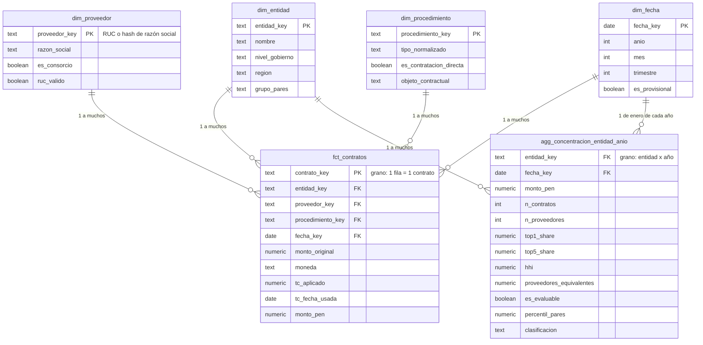

# Contrataciones Perú — Documento de planificación

24 de octubre de 2026 · Joseph

## Resumen y decisión de alcance

Con 8 horas en 2 días, la v1 es 100% local: Python → archivos raw → PostgreSQL → dbt → Power BI Desktop, con una sola pregunta central (concentración de proveedores). AWS, Terraform, S3 y los análisis secundarios pasan a un roadmap de sprints semanales posteriores.

Por qué, como se decidiría en un equipo: el plan original (sprints semanales, AWS en semana 4) suma fácilmente 30–40 horas. Meter todo en 8 horas produce un repo con muchas piezas a medias, y en una entrevista una pieza a medias resta más de lo que suma. Es mejor una v1 chica, terminada, con tests y un README honesto, que luego crece por versiones.

Decisiones tomadas a partir de tus respuestas:

| Tema | Decisión | Consecuencia |
| --- | --- | --- |
| Usuario principal | Auditor de un órgano de control (B) | El dashboard prioriza entidades a revisar, no explora libremente |
| Usuario secundario | Jefe de logística de una entidad (C) | Una página de benchmark contra entidades pares |
| Periodo | 2018 en adelante | Más volumen; la carga debe ser por archivo/periodo e idempotente desde el día 1 |
| Consorcios | El consorcio cuenta como un proveedor | Concentración subestimada; queda documentado como limitación |
| Power BI | Solo Desktop | Se entrega .pbix en el repo + capturas + video corto de 2 minutos |
| Nube | Fuera de la v1 | La arquitectura queda preparada (raw separado por periodo) para mover a S3 después |

## a. Preguntas de negocio y usuarios

El dashboard responde 3 preguntas. Las dos primeras son del auditor y la tercera es del jefe de logística.

| # | Pregunta | Usuario | Qué decide con la respuesta |
| --- | --- | --- | --- |
| P1 | ¿Qué entidades concentran su gasto contratado en pocos proveedores, y en qué grado? | Auditor de un órgano de control | Qué 10–20 entidades priorizar en su plan anual de revisión |
| P2 | ¿Qué proveedores ganan de forma recurrente en una misma entidad, y por qué tipo de procedimiento (incluida la contratación directa)? | Auditor | Qué relación entidad–proveedor revisar a fondo |
| P3 | ¿Mi entidad está más concentrada que entidades comparables, y la tendencia sube o baja? | Jefe de logística | Si conviene ampliar la difusión de convocatorias o revisar cómo se redactan los requerimientos |

Regla de redacción para todo el producto: una concentración alta es una **señal para revisar**, no una prueba de irregularidad. Hay mercados legítimamente chicos, como servicios muy especializados o zonas alejadas. Esto se dice en la página de metodología y en los tooltips. Esta frase también te sirve en una entrevista: demuestra criterio y no solo técnica.

## b. Alcance v1 y fuera de alcance

La v1 entrega una sola cosa de punta a punta: concentración de proveedores por entidad y año, de 2018 en adelante, con datos reproducibles y testeados.

**Dentro de la v1**

- Contratos registrados en el SEACE desde 2018, del Portal de Datos Abiertos del OECE, enriquecidos con los datasets de Proveedores y Consorcios y de Entidades Contratantes.
- Tipo de cambio diario SBS (venta) de BCRPData, solo para convertir a soles los contratos en moneda extranjera.
- Pipeline local: script de Python → archivos raw → PostgreSQL (`raw`) → dbt (staging, intermediate, marts) con tests → Power BI Desktop.
- Dashboard de 3 páginas: priorización de entidades, detalle de entidad y benchmark contra pares. Más una página de metodología y limitaciones.
- README con la arquitectura, cómo correrlo, la definición de las métricas y las limitaciones. Más capturas y un video de 2 minutos, porque no hay Power BI Service.

**Fuera de la v1 (queda en el roadmap)**

| Tema | Por qué queda fuera ahora | Cuándo entra |
| --- | --- | --- |
| AWS (S3) y Terraform | No cambia ninguna respuesta de negocio, y en 8 h compite con lo esencial | Sprint R1 |
| Ajuste por inflación | No afecta la concentración, que es un ratio dentro del mismo periodo; solo afecta los montos absolutos | Sprint R3 |
| Repartir el monto de los consorcios entre sus integrantes | Depende de un campo que todavía no está verificado | Sprint R2 |
| Ampliaciones de contrato (monto final) | Es un segundo dataset y requiere lógica de vigencia | Sprint R2 |
| Órdenes de compra/servicio de montos menores y catálogos de Perú Compras | Otra fuente, con otra granularidad | Fuera del proyecto, salvo que lo pidas |
| Contratación directa por región y procesos desiertos/anulados | Son análisis secundarios; en v1 la contratación directa existe solo como filtro | Sprint R3 |
| Orquestación (Airflow), CI y carga incremental en dbt | Un rebuild completo tarda minutos con este volumen | Sprint R4 |
| Publicación en Power BI Service y RLS en el servicio | No tienes acceso al Service | Si consigues acceso |

## c. Datasets, limitaciones y documentación

Verifiqué qué datasets existen y su cobertura. **No verifiqué los nombres de columnas ni el formato exacto de los archivos del portal del OECE**; eso lo resuelve el ticket CP-0 antes de modelar. Por eso este plan nombra los campos por su significado ("fecha de suscripción", "RUC del proveedor") y no por su nombre real.

| Dataset | Fuente | Uso en v1 | Qué está verificado | Limitación conocida |
| --- | --- | --- | --- | --- |
| Contratos | [Portal de Datos Abiertos del OECE](https://bi.seace.gob.pe/pentaho/api/repos/:public:portal:datosabiertos.html/content?userid=public&password=key) | Tabla de hechos | Que existe en el portal, con cobertura desde 2018 ([gob.pe](https://www.gob.pe/14272-acceder-al-portal-de-datos-abiertos-del-oece)) | No incluye procedimientos en marcha ni con adjudicación incompleta: los últimos meses están subcontados |
| Proveedores y Consorcios | Mismo portal; ficha y diccionario en la [Plataforma Nacional de Datos Abiertos](https://datosabiertos.gob.pe/dataset/proveedores-adjudicados-organismo-supervisor-de-las-contrataciones-del-estado-osce) | `dim_proveedor`, marca de consorcio | Que trae proveedores adjudicados desde 2018 con razón social, ubigeo y registro RNP, y que hay un diccionario en .xlsx | No sé si trae el % de participación de cada integrante del consorcio |
| Entidades Contratantes | Portal del OECE | `dim_entidad` (nivel de gobierno, ubicación) | Que existe | Columnas por confirmar |
| Ampliaciones de Contrato | Portal del OECE | Ninguno en v1 (roadmap R2) | Que existe | La v1 usa el monto original |
| Tipo de cambio SBS venta (código PD04640PD; euro: PD04648PD) | [BCRPData](https://estadisticas.bcrp.gob.pe/estadisticas/series/diarias) | Conversión a soles | Que la serie existe desde 1997 y es diaria | No hay dato en fines de semana ni feriados |
| Alternativa: OCDS (CSV por año) | [OCP Data Registry](https://data.open-contracting.org/en/publication/135) | Plan B si CP-0 falla | 2018–2026 pesa alrededor de 1.1 GB comprimido en CSV; licencia CC BY 4.0 | Excluye contratos sin procedimiento de selección; tiene identificadores duplicados, contratos sin estado y adjudicaciones no enlazadas a contratos |

La API de BCRPData sigue el patrón `https://estadisticas.bcrp.gob.pe/estadisticas/series/api/<códigos>/json/<inicio>/<fin>/<idioma>` ([ejemplo documentado en bcrpy](https://pypi.org/project/bcrpy/0.1.0/)). Antes de usarlo hay que confirmar el formato de fecha que acepta para las series diarias.

**Cómo se documentan las limitaciones (3 lugares, misma información):**

1. `docs/datasets.md`: una "ficha de datos" por fuente con URL, fecha de descarga, licencia, granularidad (qué es una fila), cobertura, columnas usadas y limitaciones.
2. `schema.yml` de dbt: `description` por modelo y por columna, publicado con `dbt docs generate`. Así la documentación vive junto al código y no se desactualiza.
3. Página "Metodología y limitaciones" en el dashboard. El usuario de negocio no lee el repo.

Cada descarga queda en un manifiesto (`data/raw/_manifest.csv`) con la URL, la fecha, el hash SHA-256 y el número de filas. Es la trazabilidad mínima que se espera en un equipo de datos: poder responder de dónde salió una cifra y cuándo.

## d. Métricas clave

Todas las métricas se calculan sobre la misma base:

- Monto **original** del contrato, convertido a soles (`monto_pen`).
- Agrupado por **entidad × año de suscripción**.
- Solo para las entidad-año **evaluables**.

Si cambias cualquiera de estas tres cosas, cambia el ranking. Por eso se fijan aquí y no en cada visual.

**Participación del proveedor i** en la entidad e, año t:

```latex
s_i = \frac{monto\_pen_{i,e,t}}{\sum_j monto\_pen_{j,e,t}}
```

**Índice Herfindahl-Hirschman (HHI)**, en escala de 0 a 10 000:

```latex
HHI_{e,t} = \sum_i (100 \cdot s_i)^2
```

| Métrica | Definición exacta | Cómo se lee |
| --- | --- | --- |
| Monto contratado (S/) | Suma de `monto_pen` | Tamaño del gasto |
| N.º de contratos | Conteo de contratos únicos | Sirve para ver si el HHI se apoya en suficientes casos |
| N.º de proveedores | Proveedores distintos con al menos 1 contrato | Amplitud del mercado de la entidad |
| Top 1 share | Mayor s\_i de la entidad-año | 0.60 = un proveedor se lleva el 60% del gasto |
| Top 5 share | Suma de los 5 mayores s\_i | Concentración de la "élite" de proveedores |
| HHI | Fórmula de arriba | 10 000 = un solo proveedor |
| Proveedores equivalentes | 10 000 / HHI | "Es como si la entidad comprara a N proveedores del mismo tamaño". Es la métrica más fácil de explicar a un no técnico |
| % contratación directa | Monto por contratación directa / monto total | Contexto: concentración alta con mucha contratación directa merece más atención |
| Percentil vs pares | Percentil del HHI dentro de su grupo de pares (mismo nivel de gobierno y mismo tercil de monto total) en ese año | Base de la clasificación Alta / Media / Baja |

**Entidad-año evaluable:** al menos 5 contratos y 3 proveedores en el año. Sin este filtro, una entidad con un solo contrato tiene HHI = 10 000 y encabeza el ranking sin aportar nada. El umbral es un parámetro (está en `dbt_project.yml` como `var`), así que se puede discutir con el usuario y cambiar en un solo lugar.

**Clasificación:** "Alta" es el percentil 90 o más dentro de sus pares, "Media" va del percentil 75 al 90, y "Baja" es el resto. Prefiero percentiles entre pares antes que umbrales fijos de HHI tomados de la política de competencia. Esos umbrales se diseñaron para mercados de fusiones empresariales, no para el gasto de una entidad. Los percentiles responden la pregunta real del auditor: comparada con entidades parecidas, ¿esta es atípica?

**Dónde se calculan:** el HHI no es aditivo (no se puede sumar entre entidades ni entre años). Por eso:

- La versión oficial se calcula en dbt, en `agg_concentracion_entidad_anio`.
- En Power BI hay una versión dinámica en DAX para responder a los filtros.
- Un test compara ambas para 3 entidades.

## e. Modelo estrella

La tabla de hechos es `fct_contratos`, con **1 fila = 1 contrato**. Las 4 dimensiones la filtran en relaciones 1 a muchos. La concentración se precalcula en un agregado aparte, porque el HHI no es aditivo.



> `agg_concentracion_entidad_anio` se agrega en dbt a partir de `fct_contratos`.

Por qué este grano: el contrato es la unidad que firma la entidad y la que el auditor puede revisar. Si CP-0 muestra que el dataset viene por ítem, en staging se agrega a nivel de contrato y el grano de los marts no cambia.

`agg_concentracion_entidad_anio` se relaciona con `dim_entidad` por `entidad_key`, y con `dim_fecha` por un `fecha_key` igual al 1 de enero de su año. Así el filtro de año de `dim_fecha` funciona también sobre el agregado. Un filtro por mes lo deja vacío, y eso está bien, porque el agregado es anual. Este agregado es la fuente oficial del ranking y de la clasificación. Las medidas DAX recalculan sobre `fct_contratos` solo cuando el usuario filtra por algo que el agregado no tiene, como el objeto contractual.

La moneda va como columna en el hecho y no como dimensión: son 3 valores y no tienen atributos propios. Crear una dimensión ahí sería sobre-modelar.

## f. Capas, carga incremental e idempotencia

Cada capa tiene una sola responsabilidad. Si un número está mal, se sabe en qué capa buscar.

| Capa | Dónde vive | Qué hace | Qué NO hace |
| --- | --- | --- | --- |
| Landing | `data/raw/<fuente>/<dataset>/<año>/` | Guarda el archivo tal como se descargó, más una fila en el manifiesto | Nunca se edita a mano |
| raw | PostgreSQL, esquema `raw` | Copia fiel del archivo, todas las columnas como texto, más `_source_file`, `_file_hash` y `_loaded_at` | No convierte tipos ni limpia (así un error de formato no tumba la carga) |
| staging | dbt, esquema `staging`, vistas | Un modelo por fuente: renombra a snake\_case, convierte tipos, limpia espacios, normaliza el RUC como texto de 11 dígitos, deduplica | No hace joins entre fuentes |
| intermediate | dbt, esquema `intermediate` | Lógica de negocio reutilizable: conversión a soles con el tipo de cambio, unificación de proveedores, marca de entidad evaluable | No se conecta a Power BI |
| marts | dbt, esquema `marts`, tablas | `fct_contratos`, dimensiones y `agg_concentracion_entidad_anio` | No tiene lógica que Power BI tenga que repetir |

**Carga incremental (ingesta):** la unidad de carga es el **archivo**, porque el OECE publica por periodo. Cada mes se vuelven a descargar el año en curso y el anterior, ya que las entidades registran tarde y el portal excluye lo incompleto. Los años cerrados se descargan una sola vez. Si en CP-0 resulta que el portal solo publica un archivo acumulado, se mantiene la misma lógica, solo que con un archivo único.

**Idempotencia** (correr dos veces da el mismo resultado):

1. Si el hash del archivo descargado ya está en el manifiesto, no se recarga.
2. Si el hash es nuevo, se hace en **una sola transacción**: se borran las filas de `raw` con ese `_source_file` y se insertan las nuevas. Si algo falla a la mitad, no queda nada a medias.
3. BCRPData se pide completo (2018 a hoy, son pocos miles de filas) y se hace un upsert por fecha.
4. dbt reconstruye staging y marts completos con `dbt build`. A este volumen tarda minutos, y una materialización `incremental` en dbt sería complejidad sin beneficio. Esta decisión se defiende bien en una entrevista: optimizar solo cuando duele.

**Tipo de cambio en días sin dato:** se usa el último tipo de cambio disponible en o antes de la fecha de suscripción (*as-of join*). La regla queda documentada en la columna `tc_fecha_usada`.

Este diseño ya está preparado para la nube: en el sprint R1, la carpeta landing pasa a ser un bucket de S3 con la misma estructura de rutas, y nada más cambia.

## g. Tests de calidad de datos

Los tests se dividen en dos severidades:

- **error**: el `dbt build` falla. Se usa cuando, con ese problema, el número del dashboard sería falso.
- **warn**: avisa y sigue. Se usa cuando el problema es conocido y queda medido.

Un equipo real distingue entre ambos casos. Si todo es error, la gente termina desactivando los tests.

| Test | Modelo | Cómo se implementa | Severidad |
| --- | --- | --- | --- |
| Clave del contrato única y no nula | `fct_contratos` | `unique`, `not_null` | error |
| Toda fila tiene entidad, proveedor, fecha y monto | `fct_contratos` | `not_null` | error |
| Integridad referencial hacia las dimensiones | `fct_contratos` | `relationships` | error |
| Monto mayor que 0 | `stg_contratos` | `dbt_utils.expression_is_true` | warn (se cuentan y se excluyen) |
| Moneda dentro de la lista conocida (PEN, USD, EUR) | `stg_contratos` | `accepted_values` | warn |
| Todo contrato en moneda extranjera tiene tipo de cambio | `int_contratos_pen` | Test singular en SQL | error |
| RUC válido: 11 dígitos con prefijo 10, 15, 17 o 20 | `dim_proveedor` | `expression_is_true` con regex | warn, con % reportado |
| Fecha de suscripción entre 2018-01-01 y hoy | `stg_contratos` | `expression_is_true` | warn |
| Las participaciones suman 1 por entidad-año (tolerancia 0.0001) | `agg_concentracion_entidad_anio` | Test singular | error |
| HHI entre 0 y 10 000, y top 1 ≤ top 5 ≤ 1 | `agg_concentracion_entidad_anio` | `expression_is_true` | error |
| Conciliación de filas: raw = staging + descartes documentados | staging | Test singular que compara conteos | error |
| Frescura: última carga hace menos de 45 días | source `raw` | `freshness` en `sources.yml` | warn |

Además hay un test manual que va en el README: el HHI que calcula DAX coincide con el de dbt para 3 entidades elegidas al azar. Este es el que más se cae en proyectos reales, porque la lógica de negocio queda duplicada entre la capa de datos y la herramienta de BI.

## h. Páginas del dashboard y medidas DAX

Son 4 páginas. Cada una responde una pregunta de negocio. Ninguna página existe "porque queda bonita".

| Página | Pregunta | Visuales | Filtros |
| --- | --- | --- | --- |
| 1. Priorización | P1 | 4 tarjetas (monto, contratos, entidades evaluables, % con concentración Alta) · tabla ranking de entidades (HHI, top 1, proveedores equivalentes, monto, n.º de contratos, clasificación con formato condicional) · dispersión monto vs HHI | Año, nivel de gobierno, región, objeto (bien/servicio/obra/consultoría) |
| 2. Detalle de entidad (drillthrough desde la página 1) | P2 | Barras top 10 proveedores por participación · línea de HHI por año · tabla de contratos con proveedor, procedimiento y monto · tarjeta % contratación directa | Heredados del drillthrough + año |
| 3. Benchmark | P3 | Entidad elegida vs mediana y percentil 90 de sus pares · posición de la entidad en la distribución de HHI de sus pares | Entidad (selección única), año |
| 4. Metodología y limitaciones | Todas | Texto: definiciones, umbral de evaluabilidad, limitaciones, fecha de los datos | Ninguno |

**Medidas principales** (boceto de diseño; se implementan en CP-6):

```dax
Monto PEN = SUM ( fct_contratos[monto_pen] )

HHI =
VAR total = [Monto PEN]
RETURN
    IF (
        HASONEVALUE ( dim_entidad[entidad_key] ),
        SUMX ( VALUES ( dim_proveedor[proveedor_key] ),
               DIVIDE ( [Monto PEN], total ) ^ 2 ) * 10000
    )

Top 1 Share =
DIVIDE ( MAXX ( VALUES ( dim_proveedor[proveedor_key] ), [Monto PEN] ), [Monto PEN] )

Top 5 Share =
DIVIDE (
    SUMX ( TOPN ( 5, VALUES ( dim_proveedor[proveedor_key] ), [Monto PEN] ), [Monto PEN] ),
    [Monto PEN]
)

Proveedores Equivalentes = DIVIDE ( 10000, [HHI] )

% Contratación Directa =
DIVIDE (
    CALCULATE ( [Monto PEN], dim_procedimiento[es_contratacion_directa] = TRUE () ),
    [Monto PEN]
)
```

Tres decisiones que vale la pena saber explicar:

1. **`HASONEVALUE` en el HHI**: si no hay una sola entidad en contexto, la medida devuelve vacío. Un HHI "de todo el Estado" mezclaría mercados distintos y no responde ninguna pregunta.
2. **La variable `total`**: se calcula una sola vez en el contexto de afuera. Dentro de `SUMX`, `[Monto PEN]` hace transición de contexto por proveedor. Este es el patrón que el PL-300 evalúa con más frecuencia.
3. **`TOPN` y los empates**: si hay empates, `TOPN` puede devolver más de 5 filas. Es raro con montos en soles, pero va documentado.

La tabla de fechas es `dim_fecha`, generada en dbt y marcada como *date table* en Power BI. Por eso no se usa la jerarquía automática.

## i. Riesgos y casos borde

La regla general es no borrar en silencio. Todo caso borde termina en una de dos situaciones: queda marcado con un flag, o queda excluido con un conteo visible en el README y en la página de metodología.

| Caso | Qué puede salir mal | Tratamiento en v1 |
| --- | --- | --- |
| RUC nulo o inválido | Un mismo proveedor queda partido en varios, o varios proveedores se juntan en uno | `proveedor_key` = RUC si es válido; si no, hash de la razón social normalizada (mayúsculas, sin tildes, sin "S.A.C." ni puntos). Flag `ruc_valido` y % reportado |
| Consorcios | Se subestima la concentración: la misma empresa gana sola y además dentro de consorcios | El consorcio cuenta como un proveedor, con flag `es_consorcio`. Limitación documentada; se resuelve en R2 |
| Moneda extranjera | Sumar dólares con soles infla o desinfla el ranking | Se convierte con el tipo de cambio SBS venta de la fecha de suscripción (as-of). Las monedas que no son PEN, USD ni EUR se marcan y se excluyen con conteo |
| Contratos modificados | El monto original subestima lo que realmente se pagó | La v1 usa el monto original y lo dice explícitamente. En R2 se suman las ampliaciones |
| Duplicados (mismo contrato en dos archivos o años) | Se cuenta dos veces | Deduplicación en staging por clave natural, quedándose con el archivo más reciente. El test `unique` lo garantiza |
| Meses recientes incompletos | Parece que la entidad bajó su gasto | Los últimos 2 meses se marcan como "provisional" en el dashboard |
| Montos absurdos (errores de digitación) | Un solo contrato domina el HHI de una entidad | Flag de outlier (por encima del percentil 99.9 del objeto contractual) y revisión manual de los 10 primeros |
| Entidades con muy pocos contratos | HHI = 10 000 trivial | Filtro de entidad-año evaluable (sección d) |
| Cambio normativo (Ley 30225 → Ley 32069) | Los nombres de los tipos de procedimiento cambian entre años | Seed de dbt `map_tipo_procedimiento.csv` que normaliza a categorías estables |
| Entidades renombradas o fusionadas | La serie de tiempo se corta | La clave es el código o RUC de la entidad, no el nombre |
| Codificación (tildes, Ñ) y formatos de fecha mezclados | Joins que fallan o fechas mal leídas | La lectura declara la codificación de forma explícita y la conversión de fechas es estricta en staging; si falla, va a warn, no se adivina |

## Autocrítica: los 5 puntos más débiles del plan

El punto más débil es que todavía no vimos los archivos reales. Todo lo demás depende de eso.

| # | Debilidad | Por qué importa | Mitigación |
| --- | --- | --- | --- |
| 1 | Las columnas, el formato y la granularidad del portal del OECE no están verificados | Si "Contratos" viene por ítem y no por contrato, o sin RUC del proveedor, cambian el modelo estrella y las métricas | CP-0 va primero, con un timebox de 45 min, y produce una ficha de datos. Si el portal no sirve, el plan B es OCDS en CSV, que sí está verificado |
| 2 | 8 horas es optimista para 2018–2026 + dbt (que estás aprendiendo) + Power BI | El riesgo es llegar a la hora 8 con todo al 80% | Línea de corte definida de antemano (ver el plan de sprints): primero 2023–2026, y el backfill de 2018–2022 solo si sobra tiempo. Como la carga es idempotente, agregar años después cuesta cero |
| 3 | El HHI por monto es sensible a contratos grandes y únicos (obras) | Una entidad con una sola obra enorme sale "concentrada" sin serlo en el día a día | Filtro por objeto contractual, mostrar top 1 junto al HHI y comparar contra pares. En R3 se agrega un HHI por número de contratos como segunda lectura |
| 4 | Consorcio = un proveedor subestima la concentración | Puede esconder justo el patrón que busca un auditor | Limitación explícita en el dashboard. R2 investiga si el dataset de Proveedores y Consorcios permite repartir montos |
| 5 | Usamos un solo grupo de pares (nivel de gobierno × tercil de monto) | Un municipio rural y uno de Lima pueden caer en el mismo grupo | En v1 es suficiente, y se dice. Si el usuario lo pide, se agrega región o tipo de entidad, y es un cambio en un solo modelo de dbt |

Hay un riesgo que no es técnico y que conviene tener a la vista: un ranking público de entidades "concentradas" puede leerse como una acusación. Por eso la página de metodología no es opcional y el lenguaje del producto es siempre "señal para revisión".

## Plan de sprints y tickets

La v1 es un sprint corto de 2 días (\~8 h) con 9 tickets. Después siguen 4 sprints semanales opcionales (R1–R4). Cada ticket se cierra con un PR que tú me pasas para code review, aunque trabajes solo. Es la práctica que más se parece a un equipo real.

**Definición de "listo" (aplica a todos los tickets):**

- [ ] El código está en `main` vía un PR con descripción (qué, por qué, cómo probarlo).
- [ ] `dbt build` pasa sin errores (desde CP-4 en adelante).
- [ ] No hay datos, credenciales ni `.env` en el repo.
- [ ] El README o `docs/` están actualizados si cambió algo visible.
- [ ] Pasó mi revisión, o quedan pendientes explícitos.

### Sprint v1: Día 1 (\~4 h)

| Ticket | Tiempo | Contexto | Criterios de aceptación |
| --- | --- | --- | --- |
| CP-0 Spike de datos | 45 min | Validar el supuesto más riesgoso antes de construir encima | Descargaste 1 año de Contratos, Proveedores y Consorcios y Entidades. `docs/datasets.md` tiene, por dataset: nombres reales de las columnas, qué es una fila, clave natural candidata, columnas de moneda, monto y fecha, y n.º de filas. Decisión escrita: portal OECE u OCDS |
| CP-1 Repo y entorno | 30 min | Base reproducible para cualquier persona que clone el repo | Estructura `ingestion/`, `dbt/`, `powerbi/`, `docs/`, `data/` (en .gitignore). Postgres local corriendo. `requirements.txt`. El README explica cómo levantarlo en Windows |
| CP-2 Ingesta OECE | 75 min | Raw confiable e idempotente | Script por dataset y año que descarga, escribe el manifiesto con hash y carga `raw.*` en una sola transacción. **Correrlo dos veces deja el mismo número de filas**, y la segunda vez dice "sin cambios" |
| CP-3 Ingesta BCRP | 30 min | Tipo de cambio para convertir a soles | `raw.bcrp_tipo_cambio` con PD04640PD (y PD04648PD si CP-0 encontró euros) de 2018 a hoy, con upsert por fecha |
| CP-4 dbt: sources y staging | 60 min | Primera capa limpia y testeada | `sources.yml` con freshness. Un `stg_` por fuente con tipos, RUC normalizado y deduplicación. Los tests de la sección g que aplican a staging están en verde o en warn documentado |

### Sprint v1: Día 2 (\~4 h)

| Ticket | Tiempo | Contexto | Criterios de aceptación |
| --- | --- | --- | --- |
| CP-5 Marts | 60 min | El modelo que consume Power BI | Están `dim_entidad`, `dim_proveedor`, `dim_procedimiento`, `dim_fecha`, `fct_contratos` y `agg_concentracion_entidad_anio`. Todos los tests de la sección g pasan. Hay `descriptions` en `schema.yml` |
| CP-6 Modelo en Power BI | 60 min | Semántica correcta antes que diseño | Importación desde `marts`, relaciones 1:\* de una sola dirección, `dim_fecha` marcada, medidas de la sección h. El HHI de DAX coincide con el de dbt en 3 entidades (captura en el PR) |
| CP-7 Páginas | 75 min | Responder P1–P3 | Páginas 1, 2 (con drillthrough) y 4. La página 3 entra si hay tiempo. Cada página tiene título con la pregunta que responde |
| CP-8 Cierre | 45 min | Que un reclutador lo entienda en 2 minutos | README con problema, arquitectura, cómo correrlo, métricas y limitaciones. 3 capturas, video de 2 min, `.pbix` en el repo, `dbt docs` generado |

**Línea de corte** (si a mitad del día 2 vas atrasado, se recorta en este orden): primero la página 3 de benchmark; después el backfill de 2018–2022 (se queda con 2023–2026); después el video. Nunca se recortan los tests ni la página de metodología.

### Roadmap después de la v1 (sprints de 1 semana)

| Sprint | Objetivo | Entregable |
| --- | --- | --- |
| R1 Nube | La carpeta landing pasa a S3 con Terraform, a costo $0 | Módulo Terraform (bucket, política, usuario de mínimos privilegios) y la ingesta escribiendo en S3. Antes de empezar: verificar las condiciones actuales del plan gratuito de AWS y crear una alerta de presupuesto |
| R2 Precisión | Ampliaciones de contrato y consorcios | Monto final del contrato. Reparto de consorcios si el dato existe |
| R3 Análisis secundarios | Contratación directa por región, procesos desiertos/anulados, ajuste por inflación | 2 páginas nuevas y HHI por número de contratos |
| R4 Ingeniería | CI con GitHub Actions (`dbt build` en cada PR) y orquestación simple | Pipeline que corre solo cada mes |

## Qué cubre del PL-300

El proyecto cubre bien 3 de los 4 dominios del PL-300. El cuarto, "Gestionar y proteger Power BI" (15–20% del examen), queda casi descubierto porque no tienes Power BI Service. Ese hueco lo tienes que estudiar aparte. Los pesos son los de la [guía oficial de Microsoft](https://learn.microsoft.com/certifications/resources/study-guides/pl-300).

| Dominio (peso) | Parte del proyecto | Habilidades que practicas | Qué no cubre |
| --- | --- | --- | --- |
| Preparar los datos (25–30%) | CP-0 y CP-6 | Conectar a PostgreSQL, perfilar columnas (calidad, distribución, nulos), decidir Import vs DirectQuery y saber justificarlo | Casi toda la limpieza la hace dbt y no Power Query. **Repite CP-0 en Power Query** con un archivo crudo para practicar merge, append, unpivot y tipos |
| Modelar los datos (25–30%) | CP-5 y CP-6 | Esquema estrella, cardinalidad y dirección de filtros, tabla de fechas, `CALCULATE`, transición de contexto, `SUMX`/`TOPN`, `HASONEVALUE`, variables | Time intelligence: agrega `HHI año anterior` y la variación con `SAMEPERIODLASTYEAR` o `DATEADD` |
| Visualizar y analizar (25–30%) | CP-7 | Drillthrough, formato condicional, tooltips, dispersión, detección de outliers, título como pregunta | Bookmarks, botones de navegación y diseño móvil: agrégalos a la página 1 si te sobran 20 min |
| Gestionar y proteger (15–20%) | Solo parcial | RLS en Desktop: define un rol "Región" y pruébalo con *Ver como* | Workspaces, apps, gateway, actualización programada, etiquetas de sensibilidad: solo teoría con Microsoft Learn |

Para AWS Data Engineer Associate, lo que suma de este proyecto es el sprint R1 (S3, IAM de mínimos privilegios, Terraform) y el diseño raw/staging/marts. Pero la mayor parte de ese examen está en servicios gestionados que este proyecto no toca. Conviene planificarlo como un segundo proyecto y no como una extensión de este.

## Fuentes

- [Portal de Datos Abiertos del OECE (CONOSCE)](https://bi.seace.gob.pe/pentaho/api/repos/:public:portal:datosabiertos.html/content?userid=public&password=key)
- [gob.pe: Acceder al Portal de Datos Abiertos del OECE](https://www.gob.pe/14272-acceder-al-portal-de-datos-abiertos-del-oece)
- [PNDA: Proveedores adjudicados (OECE)](https://datosabiertos.gob.pe/dataset/proveedores-adjudicados-organismo-supervisor-de-las-contrataciones-del-estado-osce)
- [OCP Data Registry: OECE (OCDS)](https://data.open-contracting.org/en/publication/135)
- [BCRPData: series diarias](https://estadisticas.bcrp.gob.pe/estadisticas/series/diarias)
- [bcrpy: ejemplo de la URL de la API del BCRP](https://pypi.org/project/bcrpy/0.1.0/)
- [Microsoft Learn: guía de estudio del PL-300](https://learn.microsoft.com/certifications/resources/study-guides/pl-300)
